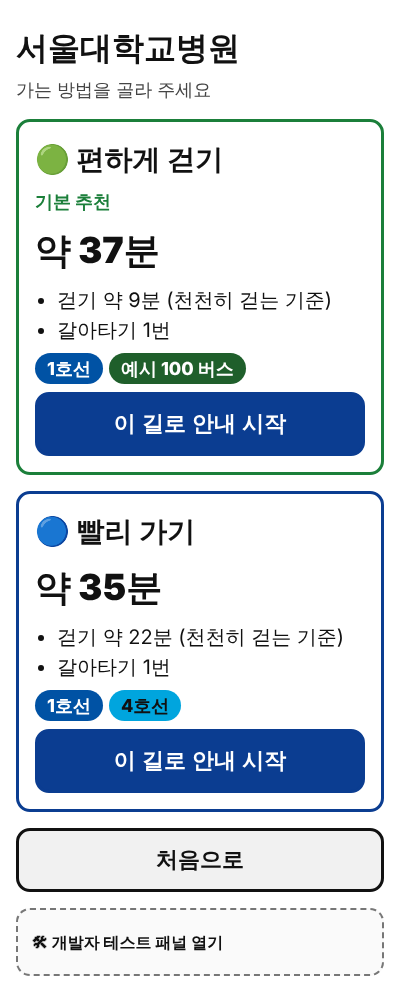
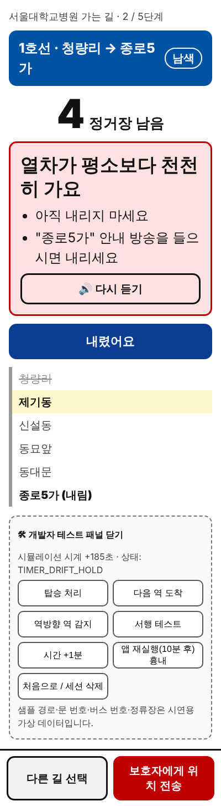
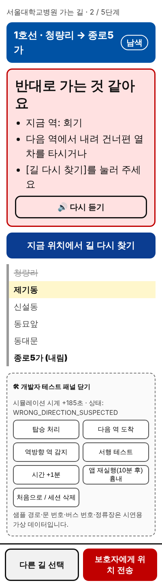

# 수도권 어르신 환승 도우미 (senior-transit-helper)

65세 이상 어르신이 서울·수도권 전철·버스를 **거꾸로 타지 않고, 헤매지 않고** 갈아탈 수 있도록 돕는 웹 앱입니다.
복잡한 지도 대신 "지금 해야 할 단 하나의 행동"을 큰 글씨·큰 버튼·음성으로 안내합니다.

- 프론트엔드: Vite + React + TypeScript
- 백엔드 프록시: Express + TypeScript (ODsay API 키를 서버에만 보관)
- 테스트: Vitest

> ODsay API 키가 없어도 **Mock 모드**로 바로 시연할 수 있습니다. 샘플 경로는 *청량리역 → 서울대병원* (전철 + 환승 + 버스)입니다.

---

## 1. 로컬 실행 가이드

### 준비물
- Node.js **20.19 이상** (22 LTS 권장) — `node -v` 로 확인
- Git

### 설치
```bash
git clone https://github.com/keumuek7-glitch/senior-transit-helper.git
cd senior-transit-helper
npm install          # 프론트 + backend-proxy(워크스페이스) 의존성을 한 번에 설치
```

### 환경 변수 (선택)
키 없이 Mock 모드로 쓸 거라면 이 단계는 건너뛰어도 됩니다(키가 없으면 자동으로 Mock 모드).

```bash
cp backend-proxy/.env.example backend-proxy/.env
```
Windows PowerShell: `Copy-Item backend-proxy/.env.example backend-proxy/.env`

| 변수 | 설명 | 기본값 |
|---|---|---|
| `ODSAY_API_KEY` | ODsay LAB에서 발급한 키. **절대 커밋하지 마세요** (`.env`는 `.gitignore`에 포함) | 비어 있음 |
| `USE_MOCK_ODSAY` | `true`면 샘플 응답 사용, `false`면 실제 ODsay 호출 | 키가 없으면 `true`처럼 동작 |
| `PORT` | 프록시 포트 | `8787` |

### 단위 테스트
```bash
npm test             # vitest run (tests/coreLogic.test.ts + backend-proxy/tests/server.test.ts)
npm run test:watch   # 파일 저장 시 자동 재실행
npm run typecheck    # 타입 검사
```

### 개발 서버 실행 (프론트 + 프록시 동시)
```bash
npm run dev
```
- 프론트: http://localhost:5173
- 프록시: http://localhost:8787 (`/api/health` 로 모드 확인)
- 프론트의 `/api/*` 요청은 `vite.config.ts`의 프록시 설정으로 8787번에 전달됩니다.

따로 띄우고 싶으면 터미널 두 개에서 `npm run dev:api`, `npm run dev:web`.

### 프로덕션 빌드
```bash
npm run build                          # 타입 검사 → dist/ (프론트) → backend-proxy/dist/ (서버)
npm start --workspace backend-proxy    # 빌드된 프록시 실행 (backend-proxy 폴더 기준으로 .env 를 읽음)
```

### 휴대폰에서 시연하기
`npm run dev:web -- --host` 로 띄우면 같은 Wi‑Fi의 휴대폰에서 `http://<PC IP>:5173` 으로 접속할 수 있습니다.
단, 위치(GPS)·음성 일부 기능은 브라우저 보안 정책상 **HTTPS 또는 localhost에서만** 동작할 수 있습니다.

---

## 2. 시연 순서 (Mock 모드)

1. 첫 화면에서 **🏥 서울대병원** 버튼을 누릅니다. (위치 권한이 없으면 청량리역 부근 시연 좌표를 씁니다)
2. 경로 선택 화면에 **🟢 편하게 걷기 / 🔵 빨리 가기** 두 개만 나옵니다.
3. **이 길로 안내 시작** → 단계별 카드가 나오고 음성으로 읽어 줍니다.
4. 화면 아래 **🛠 개발자 테스트 패널**을 열어 상황을 흉내 냅니다.

| 버튼 | 하는 일 |
|---|---|
| 탑승 처리 | "열차를 탔어요"와 같음 |
| 다음 역 도착 | 다음 정차역을 관측한 것으로 처리 (도보 단계에서는 "도착했어요") |
| 역방향 역 감지 | 탑승역 반대쪽 이웃 역(예: 청량리 → 회기)을 관측 → 반대 방향 경고 |
| 서행 테스트 | 현재 역을 관측한 뒤, 다음 역 예상 시간의 1.4배를 흘려보냄 → `TIMER_DRIFT_HOLD` |
| 시간 +1분 | 시뮬레이션 시계를 1분 앞당김 |
| 앱 재실행(10분 후) 흉내 | 세션 저장 → 10분 뒤 복원 → 하차 경과 경고 배너 |
| 처음으로 / 세션 삭제 | 진행 중 세션을 지우고 첫 화면으로 |

| 경로 선택 | 서행(TIMER_DRIFT_HOLD) | 역방향 의심 |
|---|---|---|
|  |  |  |

보호자 목적지 공유 링크 예시:
`http://localhost:5173/?dest=서울대병원&ex=126.999&ey=37.5797` (ex=경도, ey=위도, 수도권 범위 밖 좌표는 거절)

---

## 3. 구조

```
src/
  core/
    parser/odsayRouteParser.ts            ODsay 응답 → RouteCandidate[]
    classifier/seniorRouteClassifier.ts   편하게 걷기 / 빨리 가기 이분화
    stateMachine/
      transitStateMachine.ts              전철·버스 구간 상태 머신
      multiLegManager.ts                  SUBWAY_LEG ↔ TRANSFER_WALK_LEG ↔ BUS_LEG
      routeLegBuilder.ts                  RouteCandidate → RouteLeg[]
      subwayStationMapper.ts              노선 마스터 슬라이싱·역간 시간 보정
      sessionTimeReconciler.ts            앱 종료 동안 경과 시간 보정·하차 경과 경고
    metadata/                             노선색, 환승·출구 데이터 타입과 조회
    tts/guidanceSpeechBuilder.ts          카드 글 + TTS 문장 단일 소스, 발음 전처리
    guardian/                             SOS 문자, 보호자 목적지 링크
    types.ts
  hooks/                                  카드 자동 발화, 세션 저장/복원
  services/                               프록시 API 클라이언트, Web Speech 어댑터
  utils/currentLocationHelper.ts          GPS + 폴백 좌표
  components/ screens/ App.tsx            화면
  data/                                   샘플 ODsay 응답, 변환된 환승·출구 JSON
scripts/convertStationFacilities.ts       CSV/JSON → src/data/*.json 변환 CLI
backend-proxy/src/server.ts               Express 프록시 (캐시·병합·Mock)
backend-proxy/src/middleware/rateLimiter.ts
tests/coreLogic.test.ts                   핵심 로직 단위 테스트
backend-proxy/tests/server.test.ts        프록시 테스트
```

### 환승·출구 데이터 변환
```bash
npm run convert:facilities -- --transfers scripts/sample-input/rail_transfers.csv \
                              --exits scripts/sample-input/station_exits.csv --out src/data
```

---

## 4. 핵심 규칙 요약

- **보행 보정**: 도보 시간 × 1.45 (`SENIOR_WALK_FACTOR`)
- **편하게 걷기 점수** (낮을수록 좋음): 보정 도보 분 × 1.5 + 환승 × 8 + 막장 환승역(노원·고속터미널·종로3가·왕십리·신도림) × 10 − 승강기 확인 환승역 × 3 + 총 시간 × 0.3
  → 가중치는 **임의로 정한 초기값**이며 실사용으로 조정이 필요합니다.
- **빨리 가기**: 보정 반영 총 소요 시간이 가장 짧은 경로. 환승 도보가 2분 이하이면 "촉박" 경고
- 두 경로가 같으면 **가장 편하고 빠른 추천 길** 한 장으로 합침
- **TIMER_DRIFT_HOLD**: 역 관측이 들어오는 상황(관측 모드)에서 마지막 확인 역 이후 다음 역 예상 시간의 1.35배가 지나도 다음 역이 확인되지 않으면, 시간 추정으로 위치를 앞당기지 않고 하차 알림도 보류합니다.
  관측 모드에서는 위치를 관측으로만 앞당기고, 관측이 전혀 없을 때(시간 전용 모드)만 시간 추정으로 진행합니다.
- **WRONG_DIRECTION_SUSPECTED**: 예정 정차 목록에 없는 역 또는 이미 지난 역이 관측되면
- **중복 발화 방지**: `spokenKeys`(Set)를 세션 전체가 공유. 환승/출구 카드는 카드가 직접 1회 읽고, 상위 디스패처는 도보 구간에서 말하지 않음
- **TTS**: Web Speech API, `ko-KR`, rate 0.88. `4-2번 문` → `4 다시 2번 문`, `30m` → `30미터`. 화면이 백그라운드면 알림·진동 후 복귀 시 다시 읽음
- **세션 저장**: localStorage, TTL 3시간, Set ↔ Array 직렬화
- **프록시**: 좌표 소수점 4자리 정규화 키로 5분 캐시, 동시 요청 병합, 외부 호출 7초 타임아웃, IP당 분당 30회(초과 시 429 + Retry-After). 클라이언트 타임아웃 8초

---

## 5. 가정 및 확인이 필요한 부분 (중요)

이 저장소는 확인되지 않은 값을 사실처럼 쓰지 않기 위해, 아래 항목을 **가정**으로 두었습니다. 실서비스 전 반드시 확인하세요.

1. **ODsay 응답 형식**: `result.path[].info.totalTime/payment`, `subPath[].trafficType`(1=지하철, 2=버스, 3=도보), `sectionTime`, `distance`, `stationCount`, `startName/endName`, `way`, `door`, `lane[0].name/subwayCode/busNo`, `passStopList.stations[].stationName/x/y`, 오류 시 `error` 필드 — 기억에 의존한 구조이며 실제 응답으로 검증하지 않았습니다. 특히 **`door`(빠른 환승 문 번호) 필드가 실제로 오는지, 어떤 의미인지 확인되지 않았습니다.** 없으면 환승 데이터(`rail_to_rail_guides.json`)의 값으로 보충합니다.
2. **ODsay 요청 파라미터**: `SX/SY/EX/EY/apiKey` (x=경도, y=위도)로 가정. 서버용 키는 ODsay에서 **호출 서버 IP 등록**이 필요할 수 있습니다.
3. **샘플 데이터(`src/data/sampleOdsayResponse.json`)는 가상**입니다. 역 순서(1호선 회기~서울역, 4호선 성신여대입구~충무로 일부)는 실제 순서를 따랐지만, 소요 시간·거리·좌표(대략값)·문 번호(4-2, 7-1)·버스 번호(`예시 100`)·버스 정류장 이름은 시연용으로 만든 값입니다.
4. **노선 마스터의 역간 시간**은 모두 120초 균등 가정입니다(실제 구간 시간에 비율로 맞춤). 실제 역간 소요시간 공공데이터로 교체해야 합니다.
5. **노선 색상**(`subwayLineVisuals.ts`)은 널리 쓰이는 대표색 값이며 공식 가이드와 대조하지 않았습니다. ODsay `subwayCode`는 1~9호선만 번호=호선으로 가정하고, 나머지는 노선 이름으로만 매칭합니다.
6. **공공데이터 CSV 컬럼명**은 기관·연도마다 달라, 변환 스크립트는 자체 표준 컬럼명을 쓰고 `COLUMN_ALIASES`로 맞추도록 했습니다. `scripts/sample-input/*.csv`의 안내 문구도 시연용입니다.
7. **역 관측(STATION_OBSERVED)의 출처**(GPS, 비콘, 사용자 확인 등)는 아직 연결되지 않았고, 지금은 개발자 패널로만 들어옵니다. 지하 구간에서는 GPS가 잘 안 잡히므로 실제 관측 방법은 별도 설계가 필요합니다.
8. **SOS 문자**는 `sms:` 링크로 문자 앱을 여는 방식입니다(자동 발송 아님). iOS/안드로이드의 `body` 구분자 차이는 userAgent로 처리했지만 기기별 확인이 필요합니다.
